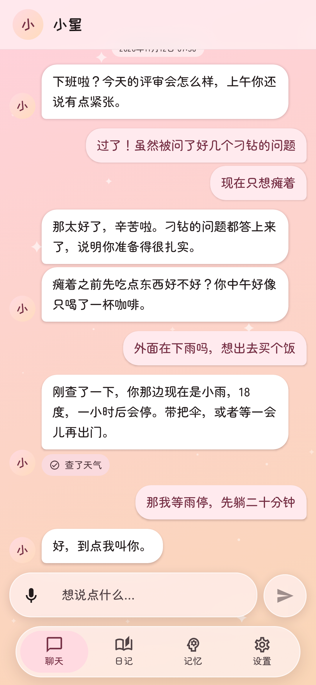
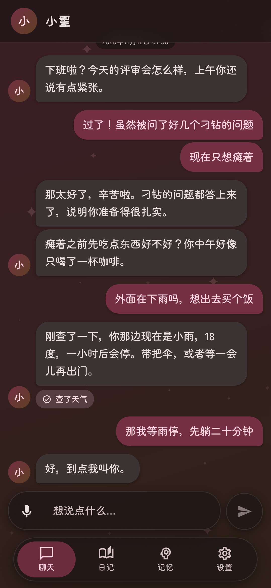
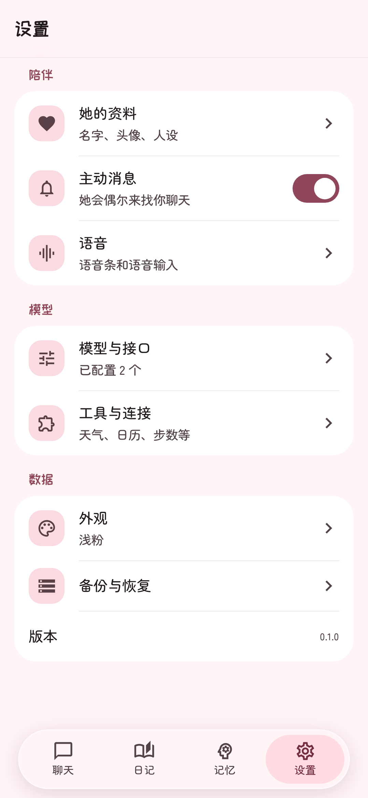

# 星伴 Starmate

跑在 Android 上的 AI 伴侣。使用你自己的模型 API key，没有服务器：聊天、记忆、日记都只存在你的手机上。

<p>
  
  
  
</p>

## 功能

- **聊天**：支持 OpenAI 兼容接口（OpenAI、DeepSeek、MiniMax、硅基流动、OpenRouter、Gemini 等）和 Anthropic 原生接口。
- **长期记忆**：记得你说过的事，久不提的琐事会慢慢淡忘。记忆页里可以查看、修改、置顶、删除。
- **主动找你**：会约好时间回来问问你，也会偶尔主动打招呼。有免打扰时段和每天的次数上限。
- **日记**：偶尔在夜里写一篇关于你们的日记，可以回复。
- **语音**：配置 TTS 后能收到她的语音条，也可以语音输入。
- **本地工具**：天气、日历、闹钟、联系人、睡眠和步数（Health Connect）、正在听的歌。每一组都要你授权后才能用。
- **联网**：Tavily 搜索和高德地图（填你自己的 key）。
- **手机操作（仅 beta 版，实验）**：在你勾选的应用里替你操作。银行、支付、券商类应用一律禁止，遇到付款页面立即停止。
- **外观**：毛玻璃、圆角，五种主题色，浅色和深色。

## 三个版本

| | 正式版 | Beta 版 | Google Play 版 |
|---|---|---|---|
| 应用名 | 星伴 | 星伴 Beta | 星伴 |
| 包名 | `org.xmyun.starmate` | `org.xmyun.starmate.beta` | `org.xmyun.starmate` |
| 获取 | GitHub Releases | GitHub Releases | Google Play |
| 手机操作 | 没有 | 有 | 没有 |
| 保活和电池优化豁免 | 有 | 有 | 没有（Play 政策不允许） |
| 举报 AI 回复 | 没有 | 没有 | 有 |

Beta 版可以和另外两个同时装在一台手机上，数据互不影响。正式版和 Play 版包名相同，只能装其中一个。想把数据从一个版本搬到另一个，用 App 里的“导入导出”。

## 隐私

- 没有后端，不收集任何数据。
- 请求只发往：你配置的模型和语音接口、Open-Meteo（天气），以及你打开的 Tavily 和高德。
- API key 用 Android Keystore 加密保存，不会出现在日志里。
- 数据不进系统云备份和换机迁移，只能用 App 里的“导入导出”转移。
- 完整说明见 [隐私政策](PRIVACY.md)。

## 安装

- 需要 Android 9 及以上，手机操作需要 Android 11 及以上。
- 从 [Releases](../../releases) 下载 APK 安装，首次打开按引导配置模型。
- 1.0 的安装包约 80 MB，因为还没有开启代码压缩。

## 自己构建

需要 JDK 21 和 Android SDK（compileSdk 37）。

```bash
./gradlew assembleStableDebug
```

其他版本把 `Stable` 换成 `Beta` 或 `Play`，例如 `./gradlew assembleBetaDebug`。

运行单元测试：

```bash
./gradlew testDebugUnitTest :app:testStableDebugUnitTest
```

构建签名的发布版：在仓库根目录新建 `keystore.properties`（已在 `.gitignore` 里，不会上传），写入：

```properties
storeFile=signing/starmate-release.jks
storePassword=你的密钥库密码
keyAlias=starmate
keyPassword=你的密钥密码
```

然后运行 `./gradlew assembleRelease`，三个版本都会打出来。没有这个文件时，得到的是未签名的安装包。上架 Google Play 用的 AAB 包用 `./gradlew bundlePlayRelease` 生成。

## 项目结构

| 模块 | 内容 |
|---|---|
| `app` | 应用入口，把各模块装配起来；`stable`、`beta`、`play` 三个变体 |
| `core/model` | 各模块共用的接口和数据结构 |
| `core/ui` | 主题、字体、毛玻璃和通用组件 |
| `core/data` | 聊天数据库、密钥加密、导入导出 |
| `core/llm` | 模型客户端（OpenAI 兼容、Anthropic） |
| `core/engine` | 对话引擎、提示词组装、工具调用 |
| `feature/*` | 聊天、记忆、日记、主动消息、语音、本地工具、MCP、手机操作（只进 beta 版） |
| `web` | 介绍页，纯静态，见 [web/README.md](web/README.md) |

更多细节见 [设计文档](docs/design.md)，真机测试步骤见 [测试清单](docs/device-test-checklist.md)。

## 已知限制

- 接口地址只接受 `https://`，`http://` 只能用于本机服务（`http://localhost`）。
- 手机操作靠屏幕文字识别付款页面，带支付功能的普通应用里可能认不出，请不要把这类应用加入白名单。
- 只在少量设备上测试过。

## 许可证

本项目以 [GPL-3.0](LICENSE) 发布。

打包的两款字体，站酷快乐体和寒蝉半圆体，使用 SIL Open Font License 1.1，见 [docs/licenses](docs/licenses/README.md)。
